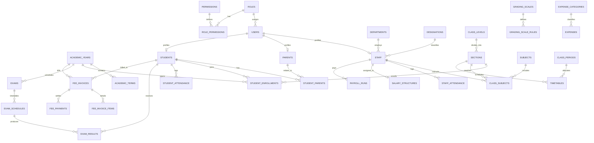

# 🏫 School Management System (SMS) Database Architecture

This repository contains the enterprise-grade relational database design for a complete **School Management System (SMS) / School ERP**. It covers all required academic, administrative, financial, and analytical operations across 13 core modules.

---

## 📁 Repository Files

| File | Purpose |
| :--- | :--- |
| [`schema.sql`](file:///c:/Users/aalaa/OneDrive/Desktop/school/schema.sql) | **PostgreSQL (v13+)** complete DDL schema with UUIDs, indexes, constraints, and dashboard views |
| [`schema_mysql.sql`](file:///c:/Users/aalaa/OneDrive/Desktop/school/schema_mysql.sql) | **MySQL (v8.0+) / MariaDB (v10.5+)** complete DDL schema with foreign keys and views |
| [`seed.sql`](file:///c:/Users/aalaa/OneDrive/Desktop/school/seed.sql) | Realistic sample data for immediate testing and demo |
| [`DATABASE_DESIGN.md`](file:///c:/Users/aalaa/OneDrive/Desktop/school/DATABASE_DESIGN.md) | Full architectural documentation, schema breakdown, and ER diagram |

---

## 🧩 Architectural Breakdown by Module

### 1. Main Dashboard & Analytics
- **Tables Queried**: Aggregates from `students`, `staff`, `fee_payments`, `fee_invoices`, `expenses`, `payroll_runs`, `student_attendance`.
- **Key Views**:
  - `vw_dashboard_kpis`: Real-time operational counters (Total active students, total staff, monthly fee collections, pending fee dues, monthly expenditures, and payroll disbursed).
  - `vw_dashboard_today_attendance`: Live daily attendance rates for students and staff.
  - `vw_class_enrollment_summary`: Section-by-section seat capacity vs. enrolled count.
  - `vw_exam_performance_summary`: Subject-level exam pass percentages, averages, and highs/lows.

### 2. Students Module
- **Core Table**: `students`
  - Stores unique `admission_number`, personal information (DOB, gender, blood group, nationality, religion), medical history, and status (`Active`, `Graduated`, `Transferred`, `Suspended`).
- **Linking Tables**:
  - `student_parents`: M:N link associating multiple parents/guardians with authorization flags (`is_primary_contact`, `can_pickup`).
  - `student_enrollments`: Tracks yearly academic session placement into class sections and roll numbers.

### 3. Parents Module
- **Core Table**: `parents`
  - Holds parent/guardian identities, relation type (`Father`, `Mother`, `Guardian`), national ID, phone numbers, email, occupation, and residential address.
  - Linked to `users` for parent portal login.

### 4. Teachers & Staff Module
- **Core Tables**: `departments`, `designations`, `staff`
  - `departments`: Academic & operational departments (e.g., Mathematics, Science, Finance).
  - `designations`: Staff roles (e.g., Senior Teacher, HOD, Accountant).
  - `staff`: Holds employee code (`staff_code`), qualifications, employment type (`Full-Time`, `Part-Time`, `Contract`), status, joining date, and banking details.

### 5. Attendance Module
- **Core Tables**: `student_attendance`, `staff_attendance`, `leave_applications`
  - `student_attendance`: Daily per-student record (`Present`, `Absent`, `Late`, `Excused`, `Half-Day`) with timestamp and recording staff member.
  - `staff_attendance`: Check-in, check-out, and status tracking for school personnel.
  - `leave_applications`: Formal leave requests for staff or students with review workflow (`Pending`, `Approved`, `Rejected`).

### 6. Classes & Subjects Module
- **Core Tables**: `class_levels`, `sections`, `subjects`, `class_subjects`
  - `class_levels`: Academic grade levels (e.g., Grade 9, Grade 10).
  - `sections`: Divisions within a grade with maximum capacity, designated classroom, and assigned class teacher.
  - `subjects`: Master course catalog (`Core`, `Elective`, credit hours).
  - `class_subjects`: Maps specific subjects to sections and assigned instructors for the academic term.

### 7. Exams & Results Module
- **Core Tables**: `grading_scales`, `grading_scale_rules`, `exams`, `exam_schedules`, `exam_results`
  - `grading_scales` & `grading_scale_rules`: Customizable letter grade configurations with min/max score boundaries and grade point equivalents (GPA).
  - `exams`: Scheduled examination events per academic term.
  - `exam_schedules`: Timetable for exam papers with max marks and pass marks.
  - `exam_results`: Marks attained per student per scheduled exam, linked to grading rules with attendance tracking (`is_absent`).

### 8. Fees & Payments Module
- **Core Tables**: `fee_categories`, `fee_structures`, `fee_invoices`, `fee_invoice_items`, `fee_payments`
  - `fee_categories`: Fee heads (Tuition, Laboratory, Transport, Library).
  - `fee_structures`: Cost per grade level per academic period.
  - `fee_invoices`: Invoices generated for students with automatic generated column `balance_due = total_amount - discount_amount - paid_amount`.
  - `fee_payments`: Receipts and transaction records with payment method (`Cash`, `Bank Transfer`, `Credit Card`, `Online Gateway`).

### 9. Expenses & Payroll Module
- **Core Tables**: `expense_categories`, `expenses`, `salary_structures`, `payroll_runs`
  - `expenses`: Operational school spending tagged with category, receipt reference, and approval officer.
  - `salary_structures`: Base compensation, allowances (housing, transport, medical), and statutory deductions per staff member.
  - `payroll_runs`: Monthly payroll batch processing with disbursement status (`Pending`, `Processing`, `Paid`), net amount, and transaction tracking.

### 10. Timetable & Calendar Module
- **Core Tables**: `class_periods`, `timetables`, `calendar_events`
  - `class_periods`: Bell schedules, defining time blocks and break slots.
  - `timetables`: Section class schedules with composite unique constraints preventing both room and teacher double-booking.
  - `calendar_events`: Academic events (Holidays, Sports Day, Parent-Teacher Conferences) targeted by audience.

### 11. Messages & Announcements Module
- **Core Tables**: `announcements`, `messages`, `system_notifications`
  - `announcements`: Broadcast announcements targeted to specific roles or school-wide.
  - `messages`: Direct peer-to-peer messaging between users with threaded conversation support (`parent_id`).
  - `system_notifications`: Automated alerts for fee overdue reminders, exam results published, and attendance notices.

### 12. Reports & Audit Trail Module
- **Core Tables & Views**:
  - `audit_logs`: Detailed audit trail capturing actor (`user_id`), action (`INSERT`, `UPDATE`, `DELETE`), target table, IP address, and JSON diffs of changes.
  - Stored database views for student transcripts, financial reconciliations, and attendance statistics.

### 13. Settings & User Permissions (RBAC) Module
- **Core Tables**: `roles`, `permissions`, `role_permissions`, `users`, `academic_years`, `academic_terms`, `system_settings`
  - Granular Role-Based Access Control (RBAC) allowing custom permissions per module and action.
  - System configuration table storing school branding, logo, active academic year, currency, and timezone.

---

## 📊 Entity-Relationship Diagram (ERD)



---

## 🚀 How to Run and Initialize

### PostgreSQL
```bash
# 1. Create the database
createdb school_db

# 2. Execute schema
psql -d school_db -f schema.sql

# 3. Load initial seed data
psql -d school_db -f seed.sql
```

### MySQL / MariaDB
```bash
# 1. Create database and apply schema
mysql -u root -p -e "CREATE DATABASE school_db CHARACTER SET utf8mb4 COLLATE utf8mb4_unicode_ci;"
mysql -u root -p school_db < schema_mysql.sql
```

---

## 📈 Sample Dashboard Queries

### 1. High-Level KPI Summary
```sql
SELECT * FROM vw_dashboard_kpis;
```
*Output gives total active students, active faculty, today's collected fees, pending fee balances, and month-to-date expenses.*

### 2. Today's Student Attendance Rate
```sql
SELECT 
    COUNT(*) AS total_students,
    COUNT(*) FILTER (WHERE status = 'Present') AS present,
    COUNT(*) FILTER (WHERE status = 'Absent') AS absent,
    ROUND(COUNT(*) FILTER (WHERE status = 'Present') * 100.0 / COUNT(*), 1) AS attendance_rate_pct
FROM student_attendance
WHERE attendance_date = CURRENT_DATE;
```

### 3. Fee Collection vs Outstanding Dues
```sql
SELECT 
    cl.name AS grade_level,
    SUM(fi.total_amount) AS total_billed,
    SUM(fi.paid_amount) AS total_collected,
    SUM(fi.balance_due) AS total_outstanding
FROM fee_invoices fi
JOIN students s ON fi.student_id = s.id
JOIN student_enrollments se ON s.id = se.student_id AND se.academic_year_id = fi.academic_year_id
JOIN sections sec ON se.section_id = sec.id
JOIN class_levels cl ON sec.class_level_id = cl.id
GROUP BY cl.name;
```
